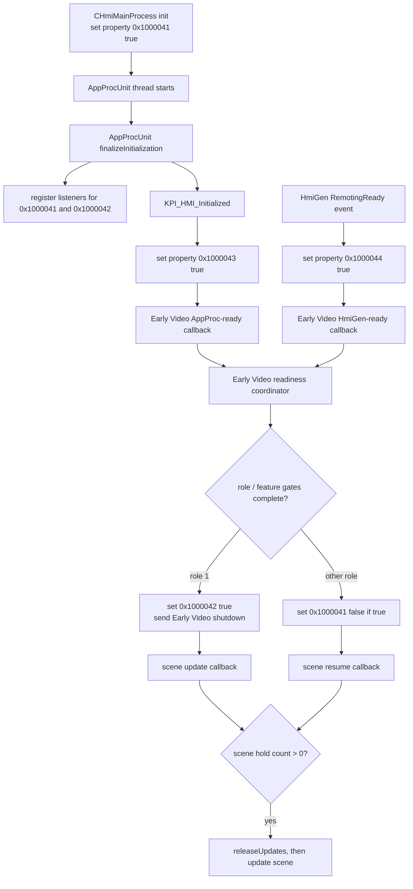

# Native HMI startup dependency trace

Updated 2026-11-04 from V84 runtime evidence and focused Ghidra 12.1.4
analysis for the selected `HmiMain3D` SHA-256
`418906bf10aeebcee6a02b8687b63a6c6e530a9263dc7171892c568e4d86845e`.
V81's read-only registry page confirms F32 camera-crane, vehicle and 2D vehicle
handles `1626342594`, `1626342596` and `1626342480`. V82/V84 use the guarded
emulator-only `icam_rvc` choice and show the real BMW home-menu activity active
and focused at native state 3; the camera-factory and empty-scene blockers are
closed.

V84 used the V67 exact-hash candidates for the 12 binaries rejected in V82.
All 12 now return `SOURCE_MAPPED`, but the final QMP frame is byte-identical to
V82 and ANGLE. OTF still shows paired pad/cursor/image/arrow appearances failing
because ten additional fragment payloads return `GL_INVALID_ENUM`. Their
hashes match staged BMW fragment `.shd` files. V85 will run BMW's QNX UniPatch
finalizer on those exact fragments; V86 will test only their validated V68
candidate sources. Fragment output lane and pixel semantics remain unverified.
RemotingBundle/DXS is separate and has no demonstrated effect on the home menu.

## V80 RemotingBundle and DXS gate

The realized `RemotingPlugin.xml` declares `CDataExchangeService` as
`IDataExchangeService`. The HmiMain3D DMMI initialization routine looks up that
interface, stores it, and asserts if the plugin instance is unavailable; the
assertion does not abort initialization. In V80, OTF logs
`RemotingBundle start: skip startup while disabled by coding` before
`ASSERTION FAILED: m_pDxsPlugin.isValid()`.

Ghidra analysis of `libhmiremoting.so` (SHA-256
`dea3aecff938db9ce27ce533ff33f72af9ee8939068125a80b3dd124577f3d56`) places
the skip in `RemotingBundle::start` at `0x276c80`. It calls the variant server
with derived feature `0x9c56`; zero logs the skip and avoids constructing the
Remoting process unit (evidence
`ev_d2d28e85231c89ea56735d37f0a632a999aa258a4738f4a924e10ce5f779cf94`). The
`CHmiVariantServer::isVariantSetInternal(EVACodingFeature)` implementation
derives `0x9c56` from these inputs:

| Derived input | Shipped coding value | Meaning |
| --- | --- | --- |
| `0x4e55` | VA feature `0x019a`, `va_REMOTE_HMI` (value 1) | Direct active-value check |
| `0x4e54` | VA `0x019d`, `va_A4A`, or `0x01a0`, `va_A4A_REMOTE_APPS` | Either alternative enables the derived input |
| `0x5264` | VA `0x00b2`, `va_TOUCH_COMMAND` | Direct active-value check |
| `0x9c55` | Any of VA `0x00f4`, `0x00f5`, `0x00f6` (`va_SPECIAL_VEHICLE`) and role 1 | Special-vehicle role path |

The derived feature is true when any listed input is true. Ghidra also shows
`isCodingFeature` compares the selected coding bits with each descriptor's
expected value. These are static mappings; they do not reveal the selected
values in V80's synthetic F32 profile. The gate is not yet tied causally to
the empty app. V81 first captures the read-only live VariantRegistry values
and app/scene lifecycle. Change coding only if that evidence and the exact F32
profile value establish a needed service.

### Coding descriptors and the plugin-app result (2026-11-11)

An earlier revision of the table above named these features with a
`_nicht_aktiv` suffix. The descriptor table in `libhmicoding.so` shows the
listed ids are the active values: `0x019a` is `va_REMOTE_HMI` (value 1), while
`0x019b` is `va_REMOTE_HMI_nicht_aktiv` (value 0) and `0x019c` the restricted
value 2.

The descriptors are 0x24-byte records in `.data` (two tables,
`0x967cc`-`0xbb018` and `0xbb018`-`0xd9954`): u16 page at `+0x08`, u16 byte at
`+0x0a`, u16 base at `+0x0e`, u8 mask at `+0x10`, u8 expected value at `+0x11`,
u32 feature id at `+0x14` and the `va_...` name pointer at `+0x18`.
`CVACoding::isCodingFeature` (`0x5222c`) tests
`((buf[base + byte] >> ctz(mask)) & (mask >> ctz(mask))) == value`. The table
reproduces every coding overlay already used here (ID6 Light, BAUREIHE_F32,
language, display size, CID resolution and touch).

| Feature | Page | Byte | Mask | Active value | Shipped default |
| --- | --- | --- | --- | --- | --- |
| `0x019a` `va_REMOTE_HMI` | `0x3000` (defaults key 7) | `0x6b` | `0x70` | 1 | 0 |
| `0x019d` `va_A4A` | `0x3000` | `0x6b` | `0x80` | 1 | 0 |
| `0x01a0` `va_A4A_REMOTE_APPS` | `0x3000` | `0x6c` | `0x01` | 1 | 0 |
| `0x00b2` `va_TOUCH_COMMAND` | `0x300b` (defaults key 15) | `0x00` | `0x01` | 1 | 0 |

So the synthetic F32 profile has every input of `0x9c56` false. The
`pluginApps = true` setting (`IDRIVE_HMI_CODING_REMOTE_HMI=1`) changes file
offset `0xdb32b` from `0x00` to `0x10`, which sets only `va_REMOTE_HMI`.

Run `20261111T072222Z` (X20511I, head unit only, headless, a third-party
plugin app staged under `/opt/hmi/ID5/data/ro/Plugins`) ties the gate to plugin
apps. With the overlay applied, `Plugin RemotingBundle had a problem during
startup` no longer appears in the serial log, HmiMain3D gains the threads
`tHMI_Remoting` and `_BMW Remoting Server`, guest RAM holds the runtime-joined
paths `/opt/hmi/data/ro//Plugins/<app>/lib<app>.so` and
`/opt/hmi/data/ro//PluginsCoded`, and the plugin app's own log shows it loaded,
created, initialised and subscribed to CDS. The same plugin staged without the
overlay left no trace. HmiMain3D stayed up and kept drawing. Not established:
whether the app-manager autostart log line itself fired (its text is a static
string in HmiMain3D), and where a `Custom` plugin app's menu entry appears in
the ID6 Light F32 menu; the Media/Radio source list is empty on this bench.

## V81 live registry and camera equipment gate

Run `v81-20261104-live-registry` reused the cached root archive and did not
repeat PSdZData extraction. After native HMI startup, an empty POST with no
fields and no `apply` parameter returned the live registry page (HTTP 200,
28,884 bytes; SHA-256
`82fafa7c5c9258078c2b2ca24bf90745bf6a567e1642b09f41a64939a80c2513`). It
reports:

| Registry key | Live handle |
| --- | ---: |
| `camera_crane_assetid` | `1626342594` |
| `vehicle_assetid` | `1626342596` |
| `vehicle2D_assetid` | `1626342480` |

OTF independently loads `/opt/hmi/data/ro/bmw/widgetasset/vehicles/F32/camera_crane/`
and F32 vehicle resources. These values prove the archive-only alias overlay
is working. Do not edit the PBVAR registry again.

The next OTF evidence is different: `CDevCameraFactory::getCameraInstance`
reports “No known camera coded, cannot instantiate camera device”, while the
integrator reports an empty app with zero states. This is a coding gate, not a
resource-handle failure.

## Ghidra camera predicate and V82 native menu result

Ghidra's HmiMain3D camera factory tests coding features `0x2d2`–`0x2d6` and
`0x272`. The first three camera values instantiate the camera path; `0x2d5` or
`0x2d6` selects XView3D. The selected `libhmicoding.so` (SHA-256
`d1b52567a853d944a2a2ad0a50361c9ab82a0825889d9deed3b9af7739774a4d`) defines:

| Feature | Coding value | Descriptor |
| --- | --- | --- |
| `0x2d2` | `CAMERA_SYSTEM_trsvc` | page `0x3001`, byte `0x3d`, mask `0x0f`, value 1 |
| `0x2d3` | `CAMERA_SYSTEM_icam_rvc` | page `0x3001`, byte `0x3d`, mask `0x0f`, value 2 |
| `0x2d4` | `CAMERA_SYSTEM_icam_high` | page `0x3001`, byte `0x3d`, mask `0x0f`, value 3 |
| `0x2d5` | `CAMERA_SYSTEM_icam2_rvc` | page `0x3001`, byte `0x3d`, mask `0x0f`, value 4 |
| `0x2d6` | `CAMERA_SYSTEM_icam2_high` | page `0x3001`, byte `0x3d`, mask `0x0f`, value 5 |

`CDsiBinaryStream::readCodingBlock` maps page `0x3001` to defaults key 5; that
entry has size `0x96` and file offset `0xdafac`. The source byte at
`0xdafe9` (`0xdafac + 0x3d`) is zero. Ghidra evidence for the page mapping,
source byte, and `icam_rvc` descriptor is respectively
`ev_904bc24e059983c26abeef3e77a6952724078def8a733debc9946b47d9b080f9`,
`ev_ea9d9de020f860c96c9c644ca0c6141df7f6df272e41d87220ec6e05f1d698ca`, and
`ev_0035290c55e92a411652a507545dfe12173f0f36ac283f281970e8da82f49084`.

The F32 profile enables `IDRIVE_HMI_CODING_CAMERA_RVC=1`. The archiver
checks the source library hash, defaults-table key/size/data offset and exact
expected byte, then writes `0x02` only into the archived library copy. It also
includes the coding selection in the archive-cache fingerprint and run
manifest. The realized root and original BMW library remain unchanged. This
models a rear-camera choice for the emulator; it is not represented as exact
PSdZData-derived vehicle coding.

V82 confirms the camera-factory assertion disappears. OTF loads
`hmicoremainmenubmw6.pba`, resolves F32 camera and vehicle assets, records
`CHmiActivityMainMenu` active/focused at `StateID=3`, and reaches `EVA finished`.
The separate `Active app: ''` timer refers to remote-app status. The camera and
scene gates are closed; do not change this coding input for V84.

## Recovered dependency chain

The diagram separates the two ready publishers. AppProc readiness and HmiGen
RemotingReady are independent inputs to Early Video; either missing callback
can keep the readiness coordinator from reaching its shutdown branch.

## Function and evidence ledger

| Code | Static finding | Evidence |
| --- | --- | --- |
| `FUN_00238c90` | `CHmiMainProcess::init` obtains property `0x1000041` and sets it true if needed. It then initializes the process, constructs the platform and AppProcUnit, and attempts `AppProcUnit::startThread`. The branch logs whether that thread started. | `ev_db35a165b2b4253401dd651eecccb5452ac592ce71d3111371c5fa3b60d91348` |
| `FUN_00218664` | After graphics initialization succeeds, obtains the scene manager and calls `holdUpdates`. | `ev_e2ec76f0577711aaa7f6c9efe2902f4b8cc7ed335c60a4f6484c591d9799759c` |
| `FUN_00227640` | Gets `CHmiSceneManager` from the plugin instance cache, lazily requests it through the current thread's plugin scope if absent, then returns the cached instance. This is the common getter used by hold/release paths. The pointer returned at runtime is not yet known. | `ev_ec15979c5a7a44e246eed4ec9c3516d069692f367386c362561b4ebc25f419bb` |
| `FUN_0021c0e4` | AppProc finalization registers listeners for properties `0x1000041` and `0x1000042` before its final KPI section. It asserts `bInitOK`, logs and prints `KPI_HMI_Initialized`, then sets `0x1000043` true. It also installs the MMI activation delegate. | `ev_57aeb2f6fc4d1c94e5c22db9aef0ba7fc74322612d73d8b82c2037dea5dcd0d0` |
| `FUN_010494c0` | `CHmiGenMain::onHmiGenEventState`: event state 1 sends a READY response; state 2 logs RemotingReady, starts AppManager autostart processing, obtains/creates property `0x1000044` and publishes true if it is not already true. | `ev_8c6ffcba52eb15c43a27889110f675bdeb212f70101ad94af2955f903ed271e0` |
| `FUN_00213330` | Early Video initialization reads `0x1000043` and `0x1000044`; if false it logs not-ready and subscribes `FUN_00212f28` / `FUN_00212e4c`. It obtains the Early Video proxy. Null or non-active state sets `0x1000041` false and registers an activation handler; active state registers a deactivation handler. It then evaluates additional feature/proxy gates. | `ev_70ef6fb97a7e7e719df23a009dcc7403bae8cabbe836e265b49c0cba79699e52` |
| `FUN_00212f28` | AppProc-ready callback returns unless property `0x1000043` is true. It logs AppProcUnitFinished, marks the AppProc readiness field, calls `FUN_002126cc`, and unregisters. | `ev_80e6c6591bbdfe6491a29739db3dcd04285328f6cb5a326308cb77da379ca16b` |
| `FUN_00212e4c` | HmiGen-ready callback returns unless property `0x1000044` is true. It logs HMIGEN Finished, marks the HmiGen readiness field, calls `FUN_002126cc`, and unregisters. | `ev_a5168b93bb6dda77276f4f17c2d61dcb3617b702c7108b2cb7d264ddff5aecdd` |
| `FUN_002126cc` | The coordinator requires readiness fields at offsets `+0x14`, `+0x15`, `+0x16`, `+0x17`, and `+0x18`. Feature IDs `0x9c56`, `0x4e71`, and `0x91c` affect three gates. For variant role 1 it sets `0x1000042` true and sends an Early Video shutdown notification. For other roles it sets `0x1000041` false only when currently true. | `ev_8d7aa3e361bba88562d56407bbf23dbb5a21e6842a7ffc221514505d13041d79` |
| `FUN_00213004` | Early Video proxy deactivation callback: if `0x1000041` is true, logs resume and sets it false. | `ev_d5db4e77fc5a36430233c2ec7847b05d1b1e27dc05510291fabec8746bf5249f` |
| `FUN_00212d84` | Proxy activation callback reads `0x1000041`; on the true branch logs activation and unregisters. It does not itself set the property. | `ev_e5d26a517af58ffb906b17dbf53a896bafb172b5fb0b24106eacc04c81afc8a2` |
| `FUN_00215444` | Property `0x1000041` callback: only when false, obtains the scene manager and releases/updates only if its hold count is positive. | `ev_f38c938e7b75e51e94738e519010a54b05a582f6bcdae2504a2cbb0fd75c8340` |
| `FUN_00215588` | Property `0x1000042` callback: when true, logs prepare-for-EVA start/end. Between those messages it checks the scene manager hold count; a positive count triggers release and update. The start/end pair alone does not prove that release ran. | `ev_bf8e6050e149c8dac01d1444569fc1bd5cd9cd5972e8feaceae370a9c33cd046` |
| `FUN_0190d600` | `holdUpdates` increments scene-manager field `+4`, logging the old and new count. | `ev_1bdd9136d1518b10be134529c24ed1dc0617aa86f9e81d110a1180fc7ca2c1d8` |
| `FUN_0190cfc8` | `releaseUpdates` decrements field `+4`, checks against underflow, and when the count reaches zero may trigger scene update work through the object at `+0xf8`. | `ev_3eef1589e0967ebf07d7a8add9e207fc4af2847e353979b4f79afb81998f7e33` |
| `FUN_0190c034` | With its second argument zero, the hold predicate is exactly `field +4 > 0`; its other mode additionally checks the override flag. | `ev_7ea6c85baad14ba3f56426ebab35b30fd060b84b05674764f06e15b61cadca04` |

Ghidra's caller search reports one resolved direct `holdUpdates` caller at
`0x218664` and two resolved direct `releaseUpdates` callers at `0x215444` and
`0x215588`; call-site coverage was complete for resolved calls. Indirect calls
remain outside that guarantee. Caller evidence IDs are
`ev_4d38a1783ed18e80eb5b0a91920ae245b0d51c9f822ca489073ebf3300318a3d` and
`ev_6f214bd44ff3342e2cc2b35ba7a4c9f96575fef4a441ddc6f3d01e827949a994`.

## Property transition table

| Property | Observed HmiMain3D writers / publisher | Readers and listeners | Open point |
| --- | --- | --- | --- |
| `0x1000041` | `CHmiMainProcess::init` sets true; Early Video initialization sets false when its proxy is absent/inactive; proxy deactivation sets false; coordinator for non-role-1 may set false. | Early Video init; proxy activation/deactivation callbacks; coordinator; AppProc callback `FUN_00215444` registered during finalize. | Runtime write ordering and the manager instance seen by each callback. |
| `0x1000042` | Coordinator sets true on role 1 after its readiness/feature gates. No explicit local false assignment was found in the inspected HmiMain3D paths. | AppProc callback `FUN_00215588`, registered during finalize. | Service default and whether all required feature gates are true in the F32 simulation. |
| `0x1000043` | Set true near the end of `FUN_0021c0e4`, after the finalization KPI block. | Early Video init and AppProc-ready callback. | No positive runtime evidence yet that V72 reaches this publication. |
| `0x1000044` | On HmiGen RemotingReady, the publisher creates/gets the property and transitions it from false to true, notifying listeners. | Early Video init and HmiGen-ready callback. | The reason HmiGen may fail to emit RemotingReady remains unknown. |

The static data does not establish every service's initial property value.
The table deliberately distinguishes explicit local writes from assumed
service defaults.

## V72 readiness hypotheses, deferred until scene import succeeds

V72's AppProcUnit thread started and its Early Video callback logged
`prepare for EVA termination, load scene start/end`. Static code maps that pair
to the true `0x1000042` callback. Since `releaseUpdates` was not logged between
the pair, the most direct static explanation is that the callback's hold-count
predicate was false (zero) at that moment, subject to OTF logging limitations.
The earlier graphics initialization log of `hold counter 0 -> 1` does not prove
the callback queried the same manager instance. `FUN_00227640` obtains the
manager through a current-thread plugin scope; runtime pointer identity must be
measured.

The hypotheses are ranked by the first observable distinction, not by assumed
root cause:

1. **A readiness publication or callback is missing.** Capture the order and
   presence of `KPI_HMI_Initialized`, property-43 publication, AppProcUnitFinished,
   HmiGen RemotingReady/property-44 publication, HMIGEN Finished, and the
   coordinator call. Existing OTF output may expose only some of these.
2. **The property-42 callback runs but sees hold count zero or a different
   scene-manager object.** At each hold/release call, record caller, scene
   manager pointer, counter before/after, and thread ID. A differing pointer
   distinguishes plugin-scope identity from a lost decrement on one object.
3. **The callback dispatch succeeds and releases the hold, but application
   selection still fails.** Follow the menu state-3 stop and empty active-app
   result only after the hold transition is proven.
4. **A required feature/proxy gate never completes.** Record each readiness
   field and the three variant feature queries, then observe the exact
   notification path. Do not alter F32 coding or synthesize service messages
   until this branch is observed.

## Runtime debugger capability

The realized QNX root contains ARM `bin/pdebug`, `bin/devc-pty`, and `bin/qconn`.
Its `opt/sys/etc/starter.cfg` already starts process 91 `/bin/devc-pty` and
process 95 `/bin/qconn`. The realized `qconn` binary reports TCP port 8000 as
its default. V74's observer incorrectly started another `devc-pty` and asked
`pdebug -f` to bind port 8000. At t+30 the serial log recorded `accept failed`
and `Unable to initialize device 8000`, so the pdebug observer was not
available. This is separate from the later t+75 failure where `io-pkt1` was no
longer running and the HMI's isolated-stack sockets returned errno 247.

The corrected profile relies on the existing `devc-pty`, starts pdebug on
isolated-stack guest port 8001, and forwards it only to host loopback
127.0.0.1:42001. V75 keeps `io-pkt1` alive through t+120 and records the guest
listener and pdebug PID. This qualifies listener setup, not a debugger client:
no HmiMain3D process has been attached or stopped by a breakpoint. V76's
loopback forward from host port 43000 to guest port 10000 tested an invalid
port assumption. V77b confirms the statically identified guest port 8080; the
8081 candidate resets. The run's private `io-pkt1` stack exits before t+75, so
pdebug loses its listener. Its cause is unknown. Pdebug remains a separate
option if the inspector cannot expose the needed live state.

QNX's documentation describes `pdebug` as a process-level debugger, requires
`devc-pty`, and permits a TCP port listener. The process-level debugger stops
the selected process's threads on a breakpoint while other processes continue
([QNX pdebug utility](https://qnx.com/developers/docs/7.1/com.qnx.doc.neutrino.utilities/topic/p/pdebug.html),
[QNX process-level debug agent](https://qnx.com/developers/docs/7.1/com.qnx.doc.neutrino.prog/topic/devel_pdebug.html)).
The target's pdebug build is dated 2012; the startup command therefore avoids
newer options not verified on this image. Host GDB/Ghidra connection and
process selection remain unqualified until the agent is running.

## VariantRegistry inspector startup gate

Ghidra analysis of HmiMain3D's `FUN_00238c90` (`CHmiMainProcess::init`,
evidence `ev_45278dace12e88c4879f9a85733de3032d44604911b473c0f9151fb15b5cf4fc`)
shows that the webserver is created only when the variant server reports
`isVariantSet(0x0709)`. It then selects port 8081 if `getRole()` returns 3,
otherwise port 8080, assigns the variant server's `htdocs` root, and calls
`CHmiWebserverService::start()`.

`libhmicoding.so` (SHA-256
`d1b52567a853d944a2a2ad0a50361c9ab82a0825889d9deed3b9af7739774a4d`) maps
`0x0709` to `va_ENTWICKLER_MENUE`: page `0x3006`, byte `0x1c`, mask `0x40`,
expected value 1. The source default at file offset `0xdaef8` is zero. The
adjacent feature `0x070a` is `va_ENTWICKLER_MENUE_nicht_aktiv`. The coding
service's `isVariantSet` routes `0x0709` through its VA-coding map
(`ev_1d4186674634a711dff239a5a1430968298bec369095700b5f6490f7f4868e8b`);
`CVACoding::isCodingFeature` looks up the descriptor and compares the selected
coding bits with its required value (`ev_efa913ab8410681caffebda541c725f2484abbc0da1caa6f9330d36e767b270d`).
The ID6 Light overlay changes page `0x3006` byte `0x1d`; by itself it leaves
the inspector bit at byte `0x1c` clear. The separate developer-menu overlay
sets only mask `0x40` in that byte.

In `libhmiwebserverservice.so` (SHA-256
`b731f1198074c071ffd50470e1c47a278828c29241de59efabfcdd099f250013`),
`start()` formats the selected port into Mongoose's `listening_ports`, sets the
variant `htdocs` document root, starts one worker and registers
`AJAX_WebWidgetEvents` (evidence
`ev_42860517d1265157b8d79364e85655c791b3d511ad278fbd9540c1b09b00a415`).
V76's private-stack socket tables at t+75 and t+120 show listeners on 5001,
4099, 1000 and 8001, but no 8080/8081. This fits the clear developer-menu
coding bit; the `-h=10000` value is unrelated, and its help string documents a
heartbeat option.

The V77b profile set only bit `0x40` at `0xdaef8` in a per-run, hash-checked
copy of `libhmicoding.so` and forwarded guest 8080/8081 to loopback ports
43000/43001. Host port 43000 returned HTTP 200 and the webinterface's
unknown-command fallback for GET `/VariantRegistry`; host port 43001 reset.
V78's empty POST to port 43000 returned the native registry page after HMI app
initialization. It contained `camera_crane_assetid=$handle:0` and
`vehicle_assetid=$handle:0`. V78 kept `io-pkt1`, port 8080 and pdebug 8001
alive through t+120. The `resourcemanager` GET timed out after ten seconds;
do not repeat that slow page request.

## V82–V84 rendering boundary and exact shader candidates

V82's immutable guest-t+120 bundle is
`build/idrive6-cache/runs/v82-20261104-f32-camera-rvc/evidence-v82-guest120/`.
It records 98 draws, 300 resources, 43 shaders and an 800×480 frame with 12,671
nonblack pixels. V83 finalized the 12 exact V82 payloads (11 vertex, one
fragment) with BMW's QNX UniPatch tool; the strict native-register translator
produced 12 SPIR-V modules accepted by `spirv-val`. V67 retains the prior 22/23
maps and adds 11/1 candidates; every asset and source hash validates.

V84's immutable guest-t+120 bundle is
`build/idrive6-cache/runs/v84-20261104-f32-shader-maps/evidence-v84-guest120/`.
It records 316 resources, 54 shader captures, 2,484 ANGLE RPCs, 3,552 GLES
traces and 4,996 provider traces, with no unsupported GLES calls. All 12 V67
additions returned `SOURCE_MAPPED`, but QMP remains byte-identical to V82:
800×480, 12,671 nonblack pixels, x=0..799/y=54..347, RGB SHA-256
`07c72f2e32af996e2b929dc0cc461d87dc2096c2a6cb09813d78469de5a0570c`. ANGLE's
final draw has the same hash, so scanout is not the current mismatch.

V84 OTF still reports failed pad, cursor, ImageNode and arrow appearances. Ten
unique missing fragment payload hashes, including byte-identical staged aliases,
are recorded in
`build/idrive6-cache/evidence/v84-unmapped-shaders/invalid-fragment-hashes.json`.
They cover `mat_pad_bg`, `mat_top`, `mat_pad`, `mat_reflection`, Image/Icon RGBA,
`mat_list_pressed`, `mat_frame_touch`, `mat_edge_inner_touch`,
`mat_highlight_main`, and `mat_arrow`. The V84 OTF errors correlate with these
fragment partners; V68 mapping must prove whether they unlock visible draws.

## Next observation: V85 finalization, then V86 fragment-map boot

V85 uses only the ten exact fragment hashes from
`build/idrive6-cache/evidence/v84-unmapped-shaders/inputs-v84-fragment.json`.
Run the existing QNX finalizer helper profile with that manifest override, then
extract its allocations and instruction tables. Require the strict translator
and `spirv-val` to accept all sources before adding them to V68. If the
translator rejects an operation family, inspect its exact stage/binary and
finalizer tables in Ghidra; do not weaken validation.

V86 keeps all profile inputs fixed except the fragment map path (V67→V68); the
vertex map remains V67. Capture at guest marker
`HMI_DIAGNOSTIC_END t+120s fds`, preserving OTF, serial, pcap, shader/resource/
draw captures, ANGLE logs and QMP. Compare ten hash-specific statuses, paired
appearance errors, active state/focus, pixel count/bounds and QMP-to-ANGLE RGB
hash. If both stages map but the image is still black, use the first failed or
empty active draw to direct further shader/material analysis. Reopen QEMU
Screen/DSS only if QMP diverges from ANGLE. Test DXS only if V86 shows a direct
home-menu dependency; keep pdebug deferred until the captured evidence leaves a
specific state unanswered.
